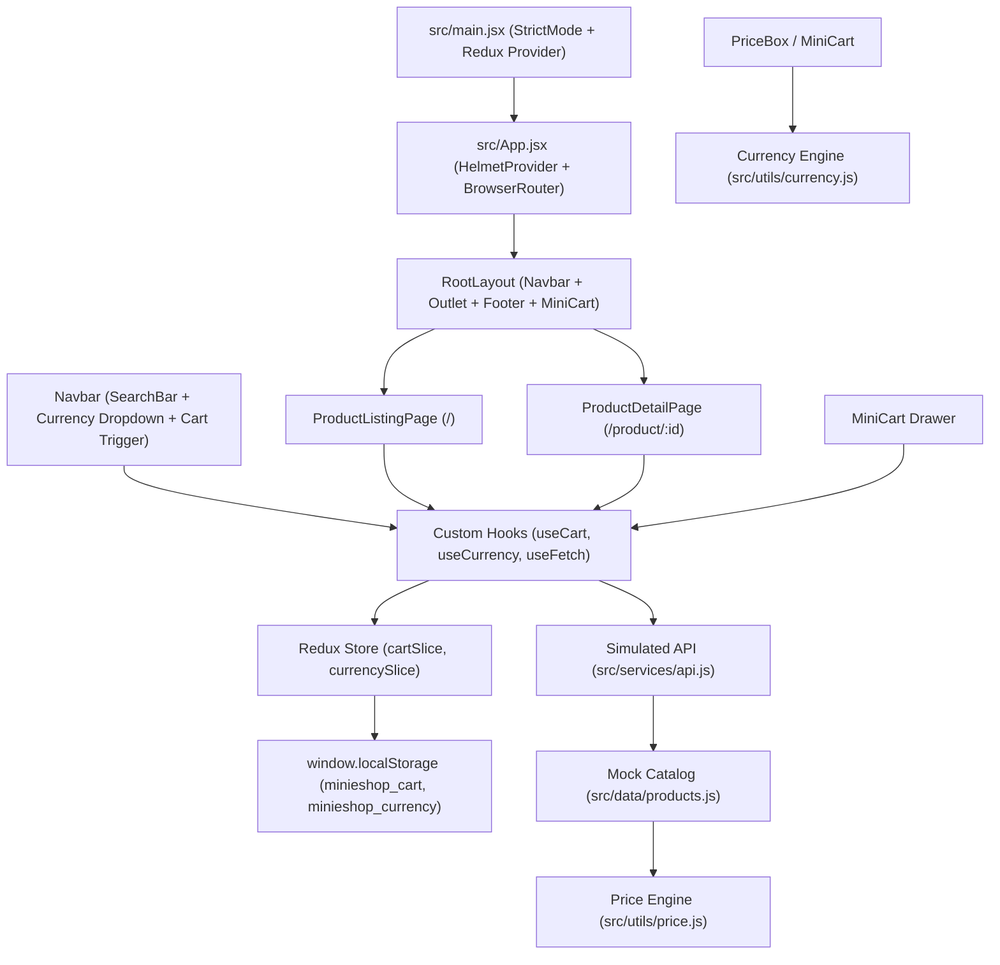

# System Architecture

## 1. Overview
**Progressive Minie Shop** is a client-side React 19 single-page application bundled by Vite 8. It follows a layered frontend architecture where routing, layout chrome, global state, async data simulation, and pure business utilities are cleanly separated.

---

## 2. Entry Points & Routing
- **`index.html`:** Declares `#root` mount container and loads `/src/main.jsx`.
- **`src/main.jsx`:** Mounts `<StrictMode>`, wraps `<App />` in Redux `<Provider store={store}>`, and imports global design tokens from `src/index.css`.
- **`src/App.jsx`:** Wraps routes in `<HelmetProvider>` and `<BrowserRouter>`. Uses React Router v7 canonical Layout Route pattern:
  - Parent `<Route element={<RootLayout />}>`
    - `index` (`/`) -> `ProductListingPage`
    - `path="product/:id"` -> `ProductDetailPage`
    - `path="*"` -> `ProductListingPage` (fallback)

---

## 3. Design System & Theming
Defined in `src/index.css` and `src/App.css`:
- **Color & Surface Tokens:** `--primary` (`#7c3aed` light / `#a855f7` dark), `--bg`, `--bg-secondary`, `--bg-tertiary`, `--card-bg`, `--card-subtle`, `--text`, `--text-heading`, `--text-muted`, `--border-color`, `--input-bg`, `--chip-bg`, `--nav-bg`.
- **Layout Tokens:** `--container-max-width: 1280px`, `--container-padding: 24px`, `--container-padding-mobile: 16px`.
- **Elevation & Typography:** `--shadow-sm`, `--shadow-md`, `--shadow-lg`, `--shadow-floating`, `--sans`, `--mono`.
- **Dark Mode Support:** Automatic `@media (prefers-color-scheme: dark)` when `:root:not([data-theme="light"])`, plus explicit `[data-theme="dark"]` and `html.dark` selectors.

---

## 4. Progressive Evolution Roadmap

| Phase | Scope | Status |
| :--- | :--- | :--- |
| **Phase 1** | Vite 8 + React 19 JS initialization + Oxlint baseline | Completed |
| **Phase 2** | Base routing (`BrowserRouter`), `HelmetProvider`, Redux `Provider` | Completed |
| **Phase 3** | PLP, `RootLayout`, `Navbar`, `Dropdown`, `PriceBox`, `ProductCard`, currency & pricing engines | Completed |
| **Phase 4** | PDP (`/product/:id`), dynamic `Helmet`, masonry gallery, 3-tab system, floating CTA, related products, `SearchBar` + `useFetch` | Completed |
| **Phase 5** | `MiniCart` slide-over drawer, debounced stock validation, `cartSlice` guardrails & `localStorage` persistence | Completed |
| **Phase 6** | Dedicated Cart page & Checkout flow | Planned |
| **Phase 7** | Incremental migration to TypeScript | Planned |
