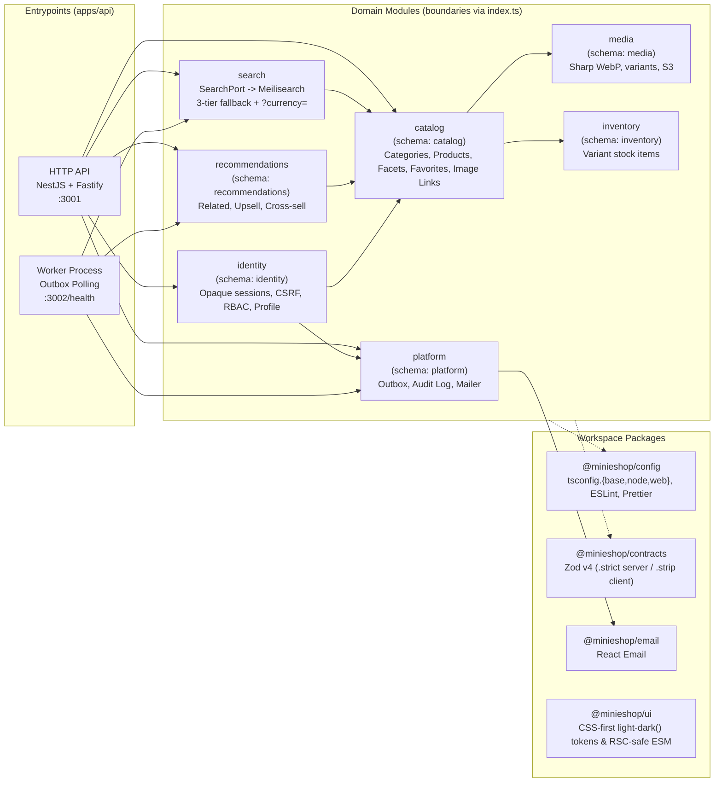
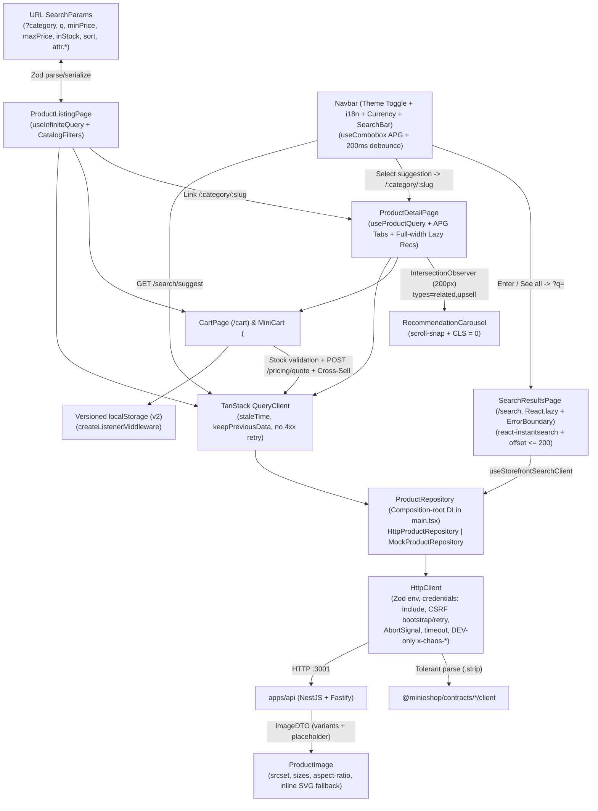

# System Architecture — Progressive Minie Shop

End-to-end architectural overview of the **react-minieshop** monorepo (`apps/storefront`, `apps/api`, `packages/ui`, `packages/contracts`, `packages/config`, `packages/email`, and `infra/`).

---

## 1. Backend Modular Monolith (`apps/api`)

The API follows a **modular monolith** architecture (`ADR-0002`, `ADR-0023`) with NestJS 11 + Fastify 5 and Drizzle ORM `0.45.4`. Module boundaries and per-schema database ownership are statically enforced by `eslint-plugin-boundaries` in `apps/api/eslint.config.mjs`—each module exposes only `index.ts` and writes strictly to its own PostgreSQL schema (`ADR-0006`).



### Key Hardening Guarantees
- **Output Contract Masking:** `parseOutput()` validates responses against `.strict()` server schemas; contract violations log structured details server-side in `GlobalExceptionFilter` and return a generic `500 INTERNAL_ERROR` envelope without leaking internal field paths.
- **Last-Admin Protection:** `StaffAdminService` filters `isActive = true` when enforcing last-admin and sole `staff:manage` invariants.
- **Production Container Image:** `apps/api/Dockerfile` separates `development` (Compose) from a compiled `production` stage (`node dist/main.js`) packaging `dist` and `drizzle` migrations only.

---

## 2. Asynchronous Outbox Flow: Outbox -> Worker -> Search / Recommendations / Email

Domain mutations record events in `platform.outbox_events` inside the **same PostgreSQL ACID transaction** (`ADR-0012`), including `EmbeddingsOutboxHandler` upserting vectors and enqueueing `product.embedding_updated` atomically. The `worker` entrypoint claims batches with `SELECT ... FOR UPDATE SKIP LOCKED`, leases, exponential backoff + jitter, and dead-letter handling:

```mermaid
sequenceDiagram
  participant API as API / Seed
  participant PG as PostgreSQL 17 (Domain + platform.outbox_events)
  participant WRK as Worker (Outbox Consumers)
  participant OLL as Ollama (embeddinggemma-2)
  participant MS as Meilisearch
  participant MP as Mailpit / Resend

  API->>PG: BEGIN; domain write + INSERT outbox_events; COMMIT
  loop Polling with SKIP LOCKED
    WRK->>PG: Claim pending rows per consumer
    alt Consumer: search-index
      WRK->>PG: Hydrate product document + embedding vector
      WRK->>MS: Upsert/Delete document in products index
    else Consumer: embeddings (profile: ai)
      WRK->>OLL: Generate 768-dim vector (embeddinggemma-2)
      WRK->>PG: BEGIN; upsert catalog.product_embeddings + enqueue product.embedding_updated; COMMIT
    else Consumer: recommendations
      WRK->>PG: Rebuild related / upsell / cross_sell scores
    else Consumer: mailer
      WRK->>MP: Send verification / password reset email (React Email)
    end
    WRK->>PG: Mark processed (or schedule retry / dead-letter)
  end
```

---

## 3. Storefront -> API Data Flow (`apps/storefront`)

The storefront separates **server state** (TanStack React Query), **URL state** (`useSearchParams` parsed/serialized with Zod), and **pure client state** (Redux Toolkit slices persisted via `createListenerMiddleware`), styled with **Tailwind CSS v4** (`ADR-0024`):



---

## 4. Storefront Layer Boundaries (Enforced by Oxlint)

`apps/storefront/.oxlintrc.json` enforces `jsx-a11y`, `import/no-cycle`, and directional layer imports (`no-restricted-imports`):

- **Domain (`src/domain/`):** `ProductRepository` port and framework-free domain error helpers (`errors.ts`). Cannot import React or `infrastructure/`.
- **Infrastructure (`src/infrastructure/`):** `HttpClient` (CSRF token cache/retry with `awaitWithAbortSignal`, `AbortSignal`, DEV-only chaos), `HttpProductRepository`, `MockProductRepository`, `queryStrings.ts`, and `instantSearchAdapter.ts`.
- **Composition Root & Context (`src/main.tsx`, `src/context/`):** Instantiates `HttpProductRepository` at app boot and injects it via `ProductRepositoryProvider` (zero concrete infrastructure import inside `context/`).
- **Hooks & Server State (`src/query/`, `src/hooks/`):** Domain facades (`useCart`, `useCartActions`, `useCurrency`, `useTheme`, `useFavorites`, `useProducts`, `useSearch`, `useRecommendations`, `useCombobox`, `useInView`, `useDevChaos`, `useDebounce`).
- **Client State (`src/store/`):** Pure `cartSlice` (frozen in Phase 7) and pure `currencySlice`, memoized `createSelector` derivations (`cartSelectors.ts`), and `createListenerMiddleware` persistence (`cartStorage.ts`, `currencyStorage.ts`, including `applyCartQuote` persistence).
- **UI, Accessibility & Styling (`src/layouts/`, `src/components/`, `src/pages/`, `src/index.css`):** Single `<main id="main-content">` + Skip Link in `RootLayout`, route & lazy-chunk `<ErrorBoundary>`, native `<dialog>` `MiniCart`, WAI-ARIA APG keyboard controls (`SearchBar`, `Dropdown`, PDP `Tabs`), and unified Tailwind CSS v4 semantic utilities backed by `@minieshop/ui/styles.css` (`light-dark()` tokens, `Baseline 2024+`, `html[data-theme]`, zero legacy `.css` files, `ADR-0024`, `ADR-0025`).

---

## 5. Architecture Decision Records

All incremental architectural decisions are recorded in [`docs/adr/README.md`](./adr/README.md) (`ADR-0001` through `ADR-0025`).
