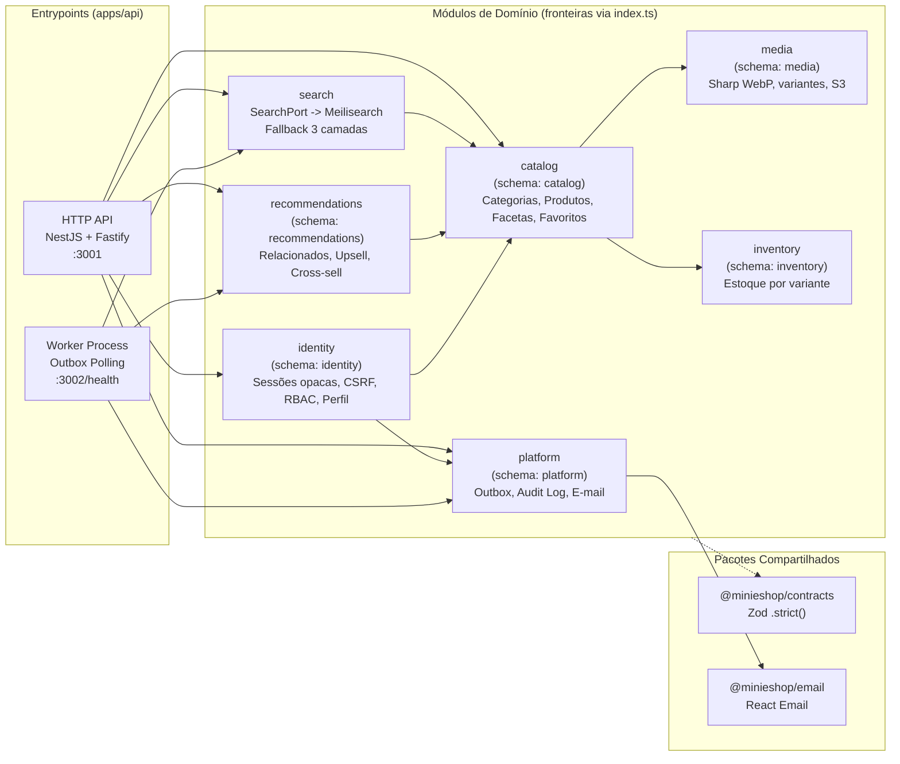
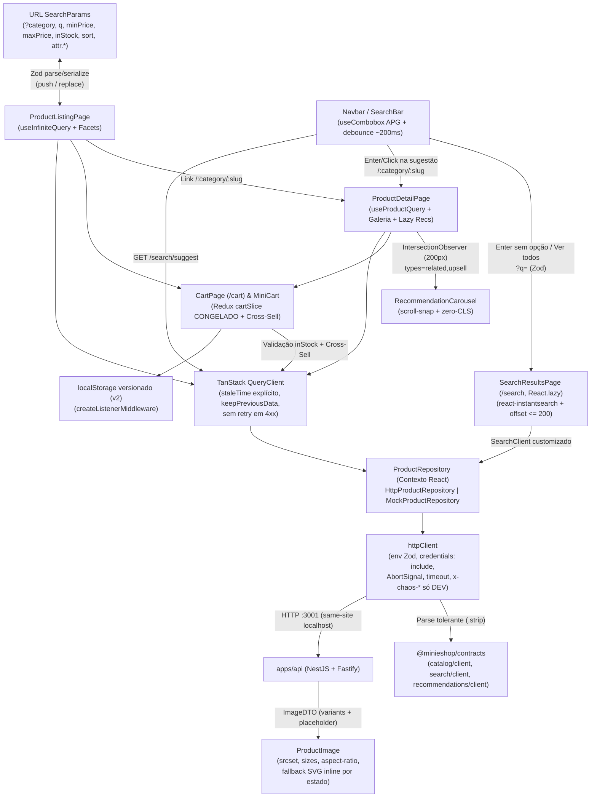

# Arquitetura do Sistema — Progressive Minie Shop

Visão arquitetural completa do monorepo (`apps/storefront`, `apps/api`, `packages/contracts`, `packages/config`, `packages/email` e `infra/`).

---

## 1. Módulos do Backend (`apps/api`)

A API segue o estilo de **monolito modular** (`ADR-0002`), com fronteiras verificadas por `eslint-plugin-boundaries` (cada módulo expõe apenas `index.ts`) e isolamento de persistência com um schema PostgreSQL por domínio (`ADR-0006`):



---

## 2. Fluxo Assíncrono: Outbox → Worker → Índice / Recomendações / E-mail

Mutações de catálogo, mídia e identidade gravam eventos na tabela `platform.outbox_events` na **mesma transação ACID** do PostgreSQL (`ADR-0012`). O processo `worker` consome eventos com `SELECT ... FOR UPDATE SKIP LOCKED`, retentativas com backoff e dead-letter:

```mermaid
sequenceDiagram
  participant API as API / Seed
  participant PG as PostgreSQL (Domínio + platform.outbox_events)
  participant WRK as Worker (Outbox Consumers)
  participant OLL as Ollama (profile: ai)
  participant MS as Meilisearch
  participant MP as Mailpit / Resend

  API->>PG: BEGIN; grava mutação + INSERT outbox_events; COMMIT
  loop Polling com SKIP LOCKED
    WRK->>PG: Busca eventos pendentes por consumer
    alt Consumer: search-index
      WRK->>PG: Hidrata documento + embedding (se existir)
      WRK->>MS: Upsert/Delete documento no índice products
    else Consumer: embeddings (profile ai)
      WRK->>OLL: Gera vetor (768 dims)
      WRK->>PG: Persiste em catalog.product_embeddings (pgvector)
    else Consumer: recommendations
      WRK->>PG: Recalcula related / upsell / cross_sell
    else Consumer: email
      WRK->>MP: Envia verificação / reset de senha (React Email)
    end
    WRK->>PG: Marca evento como processado (ou agenda retry/DLQ)
  end
```

---

## 3. Fluxo Storefront → API (`apps/storefront`)

O storefront separa rigorosamente **estado de servidor** (TanStack React Query) de **estado local/cliente** (Redux Toolkit para o carrinho e `useSearchParams` da URL para filtros):



---

## 4. Camadas e Fronteiras do Storefront

- **Domínio (`src/domain/`):** interface `ProductRepository` (catálogo, busca, sugestões e recomendações) e tipos derivados de `@minieshop/contracts`.
- **Infraestrutura (`src/infrastructure/`):** `httpClient`, mapeamento de erros (`ApiError`, `NetworkError`, `ContractViolationError`), adaptador `createStorefrontSearchClient` (`src/infrastructure/search/instantSearchAdapter.ts`) para `react-instantsearch`, `HttpProductRepository`, `MockProductRepository` (com simulação dos três modos de busca e falhas) e leitura DEV-only de cabeçalhos de caos (`x-chaos-*`).
- **Estado de Servidor (`src/query/`, `src/hooks/useProducts.ts`, `src/hooks/useSearch.ts`, `src/hooks/useRecommendations.ts`, `src/hooks/useFavorites.ts`):** `useInfiniteQuery` para cursor pagination, `useQuery` para categorias/facetas/PDP/sugestões/recomendações/favoritos e `useMutation` otimista para favoritos com rollback.
- **Estado de Cliente (`src/store/`, `src/hooks/useCart.ts`, `src/hooks/useCombobox.ts`):** Redux Toolkit `cartSlice` (congelado na Fase 7), `createSelector` memoizado (incluindo `selectRecentCartProductIds` limitado a 20 IDs distintos), `cartStorage.ts` versionado (v2) com `createListenerMiddleware`, cálculos 100% em centavos inteiros e hook headless `useCombobox` (WAI-ARIA APG).
- **UI e Resiliência (`src/components/`, `src/pages/`):** `SearchBar` com combobox APG acessível persistente no cabeçalho em toda a navegação (inclusive em `/search`, sincronizado com `?q=`), rota lazy `SearchResultsPage` (`/search`), `RecommendationCarousel` acessível com `scroll-snap` e reserva de altura zero-CLS (`useInView` na PDP e cross-sell inline sem abrir o `MiniCart` em `/cart`), `ProductImage` com fallback SVG inline (`ADR-0005`), `CatalogFilters`, `formatMoney` na borda e camada i18n (`en` + `pt-BR`).

---

## 5. Governança de Decisões (ADRs)

Todas as decisões arquiteturais do projeto estão registradas de forma incremental em [`docs/adr/README.md`](./adr/README.md) (`ADR-0001` até `ADR-0021`).
