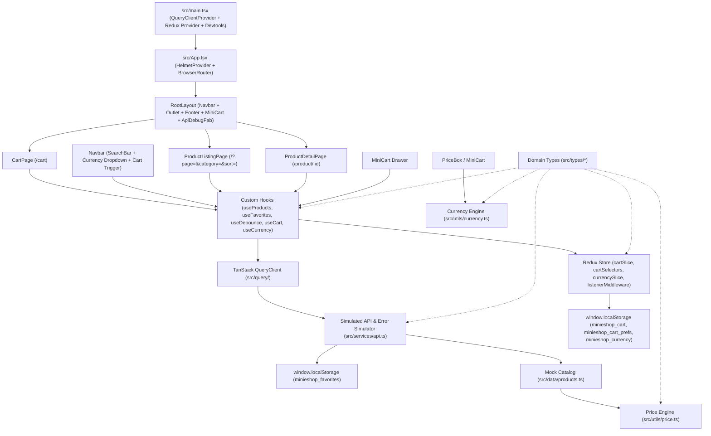

# System Architecture

## 1. Overview
**Progressive Minie Shop** is a client-side React 19 single-page application bundled by Vite 8 and authored in strict TypeScript. It separates persistent client UI state (Redux Toolkit) from cached asynchronous server state (TanStack React Query), while keeping routing, layout chrome, simulated API boundaries, domain types, and pure business utilities decoupled.

---

## 2. Entry Points & Routing
- **`index.html`:** Declares `#root` mount container and loads `/src/main.tsx`.
- **`src/main.tsx`:** Verifies `#root` existence (`throw new Error` guard), mounts `<StrictMode>`, wraps `<App />` in `<QueryClientProvider client={queryClient}>` and Redux `<Provider store={store}>`, and mounts `<ReactQueryDevtools buttonPosition="bottom-right" />` in development mode.
- **`src/App.tsx`:** Wraps routes in `<HelmetProvider>` and `<BrowserRouter>`. Uses React Router v7 canonical Layout Route pattern:
  - Parent `<Route element={<RootLayout />}>`
    - `index` (`/`) -> `ProductListingPage`
    - `path="product/:id"` -> `ProductDetailPage`
    - `path="cart"` -> `CartPage`
    - `path="*"` -> `ProductListingPage` (fallback)

---

## 3. Server State vs. Client State
- **TanStack React Query (`src/query/` & `src/hooks/useProducts.ts`, `src/hooks/useFavorites.ts`):** Manages catalog queries (`keepPreviousData`), category metadata, PDP details & related items, debounced search autocomplete, debounced cart stock validation, and optimistic-update Favorites mutations (`staleTime: 2m`, `gcTime: 10m`, smart `retry: 2`).
- **Redux Toolkit (`src/store/` & `src/hooks/useCart.ts`, `src/hooks/useCurrency.ts`):** Manages synchronous client state (`cart` and `currency`) persisted to `localStorage`.

---

## 4. Design System & Theming
Defined in `src/index.css` and `src/App.css`:
- **Color & Surface Tokens:** `--primary` (`#7c3aed` light / `#a855f7` dark), `--bg`, `--bg-secondary`, `--bg-tertiary`, `--card-bg`, `--card-subtle`, `--text`, `--text-heading`, `--text-muted`, `--border-color`, `--input-bg`, `--chip-bg`, `--nav-bg`.
- **Layout Tokens:** `--container-max-width: 1280px`, `--container-padding: 24px`, `--container-padding-mobile: 16px`.
- **Elevation & Typography:** `--shadow-sm`, `--shadow-md`, `--shadow-lg`, `--shadow-floating`, `--sans`, `--mono`.
- **Dark Mode Support:** Automatic `@media (prefers-color-scheme: dark)` when `:root:not([data-theme="light"])`, plus explicit `[data-theme="dark"]` and `html.dark` selectors.

---

## 5. Progressive Evolution Roadmap

| Phase | Scope | Status |
| :--- | :--- | :--- |
| **Phase 1** | Vite 8 + React 19 JS initialization + Oxlint baseline | Completed |
| **Phase 2** | Base routing (`BrowserRouter`), `HelmetProvider`, Redux `Provider` | Completed |
| **Phase 3** | PLP, `RootLayout`, `Navbar`, `Dropdown`, `PriceBox`, `ProductCard`, currency & pricing engines | Completed |
| **Phase 4** | PDP (`/product/:id`), dynamic `Helmet`, masonry gallery, 3-tab system, floating CTA, related products, `SearchBar` | Completed |
| **Phase 5** | `MiniCart` slide-over drawer, debounced stock validation, `cartSlice` guardrails & `localStorage` persistence | Completed |
| **Pre-Phase 6** | Incremental TypeScript migration (`SDD-0003` / `ADR-0006`) | Completed |
| **Post-Phase 5** | TanStack React Query migration (`SDD-0004` / `ADR-0007`), URL pagination, optimistic Favorites, `ApiDebugFab` | Completed |
| **Phase 6 (Inc. 1)** | Dedicated Cart page (`/cart`) with monolithic Context + `useReducer` (`SDD-0001` / `ADR-0008`) | Superseded by Inc. 2 |
| **Phase 6 (Inc. 2)** | Pure Redux Toolkit `cartSlice`, memoized `createSelector`, `localStorage` listener, Vitest + React `<Profiler>` (`SDD-0001` / `ADR-0009` / `ADR-0010`) | Implemented |
| **Phase 6 (Inc. 3)** | Checkout flow & order confirmation (`SDD-0001`) | Planned |
