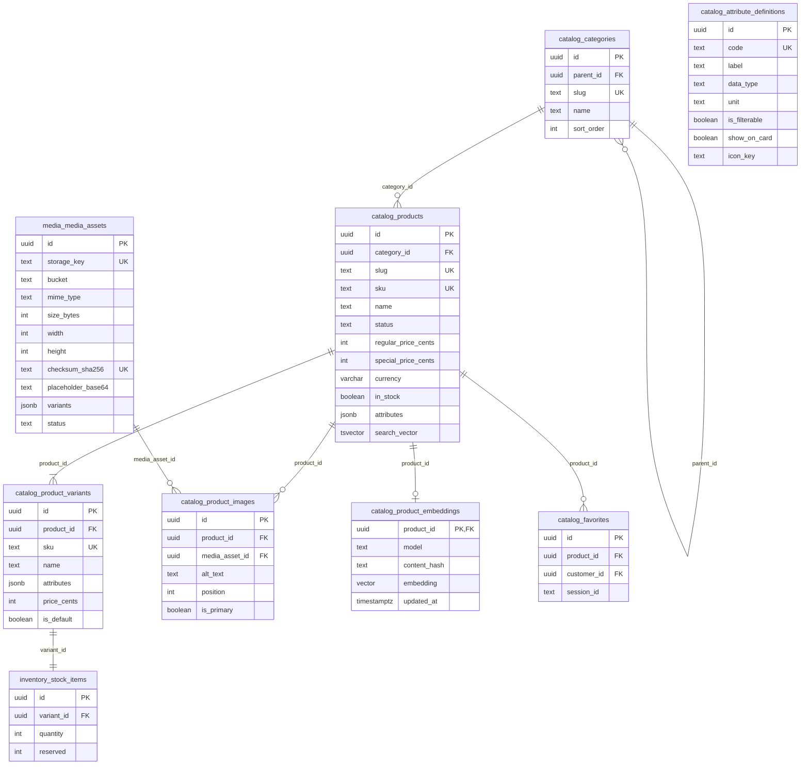
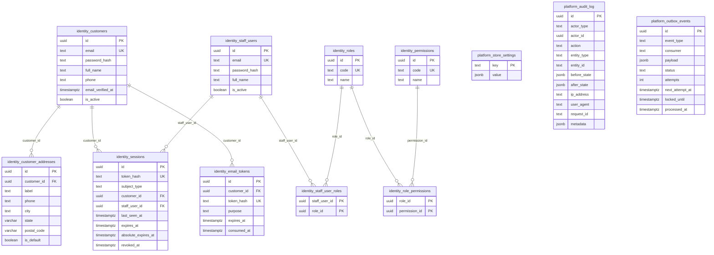
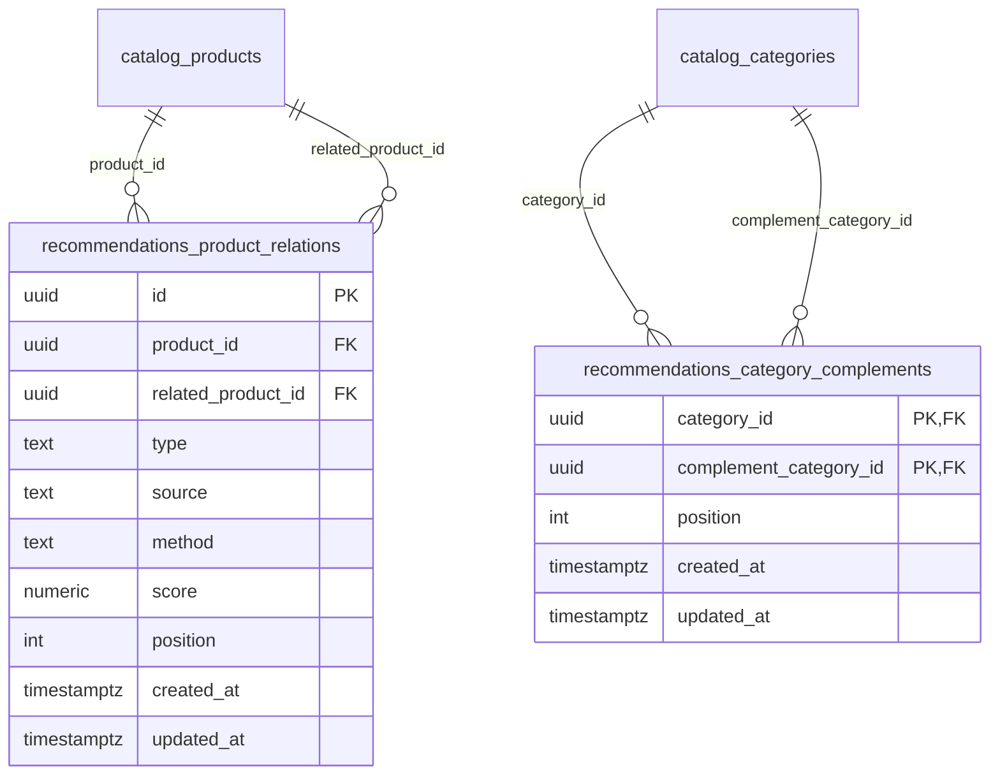

# Database Model (`PostgreSQL 17 + pgvector`)

Relational data model for **Progressive Minie Shop** running on PostgreSQL 17 (`pgvector/pgvector:pg17`), organized with **one PostgreSQL schema per domain module** per [`ADR-0006`](./adr/0006-organizacao-banco-schemas-por-modulo.md) and statically enforced by per-schema ESLint boundaries in `apps/api/eslint.config.mjs` (`ADR-0023`).

---

## 1. Schemas & Extensions

- **Extensions (migration `0000`):** `pgcrypto`, `vector` (`pgvector`), `unaccent`.
- **Module-Owned Schemas:**
  - `catalog` — category hierarchy, products, product variants, attribute definitions, product image links (exclusively written by `CatalogService`), product embeddings (`pgvector` 768-dim, `ADR-0011` / `ADR-0022`), and favorites.
  - `media` — object-storage asset metadata and generated WebP variant descriptors (binary bytes live in SeaweedFS/S3, never in PostgreSQL).
  - `inventory` — physical stock quantities and reservations per product variant.
  - `identity` — customers, customer addresses, opaque sessions, signed email tokens, staff users, roles, and RBAC permissions (`ADR-0007`, `ADR-0014`, `ADR-0015`).
  - `platform` — store settings, immutable audit trail (`platform.audit_log`), and transactional outbox (`platform.outbox_events`, `ADR-0012`).
  - `recommendations` — pre-computed product relations (`recommendations.product_relations`) and complementary category map (`recommendations.category_complements`, `ADR-0013`).

---

## 2. Entity-Relationship Diagrams by Module

### `catalog` + `media` + `inventory`

### `identity` + `platform`

### `recommendations`

---

## 3. Key Constraints & Indexes

- **Pricing (integer cents):** `regular_price_cents >= 0`, `special_price_cents IS NULL OR (special_price_cents >= 0 AND special_price_cents <= regular_price_cents)`, `product_variants.price_cents IS NULL OR price_cents >= 0`.
- **Inventory (`inventory.stock_items`):** `quantity >= 0`, `reserved >= 0`, `reserved <= quantity`, `variant_id UNIQUE`.
- **Media (`media.media_assets`):** `status IN ('pending', 'ready', 'failed')`, `storage_key UNIQUE`, `checksum_sha256 UNIQUE`, `size_bytes > 0`. Product image association writes live exclusively in `CatalogService.linkProductImage` (`catalog.product_images`).
- **Catalog Search & Embeddings (`catalog.products`, `catalog.product_embeddings`):**
  - `status IN ('draft', 'published', 'archived')` (`products_status_idx`) and `CHECK (slug <> 'facets')` (`ADR-0008`).
  - `search_vector` (`tsvector`) maintained via `BEFORE INSERT OR UPDATE` trigger using `to_tsvector('portuguese', public.unaccent(...))` with weights `A` (`name`) and `B` (`description`), indexed with **GIN**.
  - `attributes` (`jsonb`) indexed with **GIN**; B-tree indexes on `category_id`, `regular_price_cents`, and `special_price_cents`.
  - `catalog.product_embeddings` stores 768-dimensional vectors generated by `embeddinggemma-2` (`ADR-0022`) with HNSW `vector_cosine_ops` index and `content_hash` idempotency guard.
- **Favorites (`catalog.favorites`):** Requires `customer_id IS NOT NULL OR session_id IS NOT NULL`, with partial unique indexes on `(customer_id, product_id)` and `(session_id, product_id)`.
- **Recommendations (`recommendations.product_relations`, `recommendations.category_complements`):**
  - `product_relations`: `product_id <> related_product_id`, `UNIQUE (product_id, related_product_id, type)`, `type IN ('related', 'upsell', 'cross_sell')`, `source IN ('manual', 'auto')`, `method IN ('vector', 'rule', 'manual')`, manual/auto score invariants, `position >= 0`, `ON DELETE CASCADE` FKs to `catalog.products(id)`.
  - `category_complements`: `PRIMARY KEY (category_id, complement_category_id)`, `category_id <> complement_category_id`, `position >= 0`, `ON DELETE CASCADE` FKs to `catalog.categories(id)`.
- **Identity, Sessions & Audit (`identity.*`, `platform.audit_log`, `platform.outbox_events`):**
  - Partial unique index `customer_addresses_default_uidx (customer_id) WHERE is_default = true`.
  - Dual expiration (`expires_at` idle + `absolute_expires_at` hard cap) and `last_seen_at` on `identity.sessions`.
  - Structured `before_state`, `after_state`, `ip_address`, `user_agent`, and `request_id` columns on `platform.audit_log`.
  - `platform.outbox_events` polled with `SELECT ... FOR UPDATE SKIP LOCKED` and per-consumer rows (`ADR-0012`).
- **Cross-Schema FKs:** Strictly reference primary keys (`id`) of owning tables only (`ADR-0006`).
