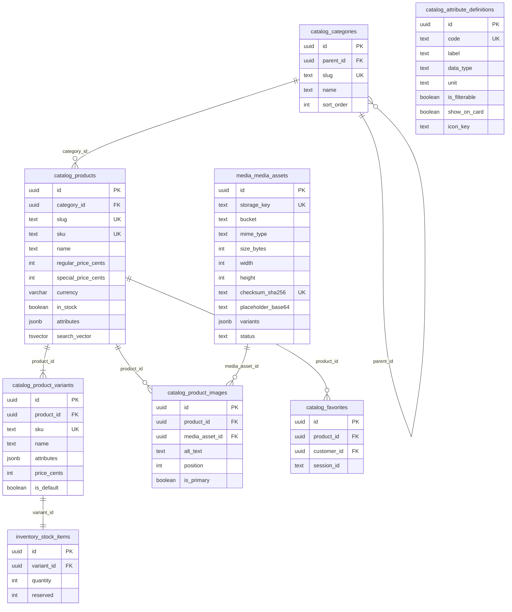
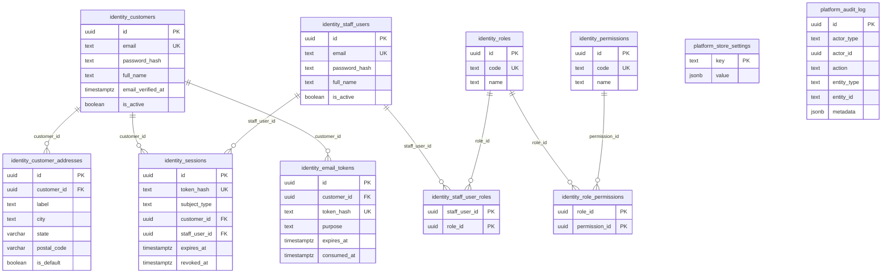

# Modelo de Banco de Dados (`T07`)

Documentação do modelo relacional do **Progressive Minie Shop** em PostgreSQL 17 (`pgvector/pgvector:pg17`), organizado com **um schema por módulo** conforme [`ADR-0006`](./adr/0006-organizacao-banco-schemas-por-modulo.md) e [`ADR-0007`](./adr/0007-autenticacao-sessoes-opacas-propria.md).

---

## 1. Schemas e Extensões

- **Extensões criadas na migration `0000`:** `pgcrypto`, `vector` (`pgvector`), `unaccent`.
- **Schemas:**
  - `catalog` — árvore de categorias, produtos, variantes, definições de atributos, imagens de produto e favoritos.
  - `media` — metadados de ativos de mídia no object storage (bytes nunca vão para o banco).
  - `inventory` — controle de estoque físico e reservas por variante.
  - `identity` — tabelas de clientes, endereços, sessões opacas, tokens de e-mail, staff e RBAC (implementação de auth fica para fase posterior).
  - `platform` — configurações da loja e trilha de auditoria.
  - `recommendations` — schema reservado para fases futuras (sem tabelas na Fase 1; `product_embeddings` e `outbox` ficam fora da Fase 1).

---

## 2. Diagrama ER por Módulo

### `catalog` + `media` + `inventory`

### `identity` + `platform`

---

## 3. Constraints e Índices Principais

- **Preços:** `regular_price_cents >= 0`, `special_price_cents IS NULL OR (special_price_cents >= 0 AND special_price_cents <= regular_price_cents)`, `product_variants.price_cents IS NULL OR price_cents >= 0`.
- **Estoque (`inventory.stock_items`):** `quantity >= 0`, `reserved >= 0`, `reserved <= quantity`, `variant_id UNIQUE`.
- **Mídia (`media.media_assets`):** `status IN ('pending', 'ready', 'failed')`, `storage_key UNIQUE`, `checksum_sha256 UNIQUE`, `size_bytes > 0`.
- **Busca textual e filtros (`catalog.products`):**
  - `search_vector` (`tsvector`) atualizado automaticamente via trigger `BEFORE INSERT OR UPDATE` usando `to_tsvector('portuguese', public.unaccent(...))` com pesos `A` (`name`) e `B` (`description`), indexado com **GIN**.
  - `attributes` (`jsonb`) indexado com **GIN**.
  - Índices B-tree em `category_id`, `regular_price_cents` e `special_price_cents`.
- **Favoritos (`catalog.favorites`):** exige `customer_id IS NOT NULL OR session_id IS NOT NULL`, com índices únicos parciais por `(customer_id, product_id)` e `(session_id, product_id)`.
- **FKs entre schemas:** apontam exclusivamente para a chave primária (`id`) da tabela dona (`ADR-0006`).
