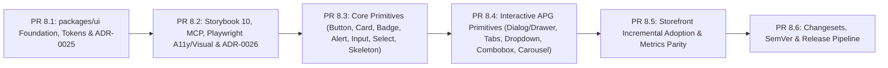

# SDD-0006: Phase 8 — Design System (`@minieshop/ui`, Storybook 10 + MCP, Testing Pyramid & Publishing)

- **Status:** In Progress (Slice 1 Implemented)
- **Phase:** Phase 8 — Design System (Protagonist Milestone)
- **Author:** Architecture & Engineering
- **Date:** 2026-11-28
- **Related ADRs:**
  - Existing: [`ADR-0016`](../adr/0016-monorepo-pnpm-workspaces-turborepo.md), [`ADR-0020`](../adr/0020-combobox-autocomplete-apg-proprio.md), [`ADR-0023`](../adr/0023-monorepo-package-boundaries-stack-typescript-and-contracts.md), [`ADR-0024`](../adr/0024-tailwind-v4-semantic-tokens-and-theme-activation.md), [`ADR-0025`](../adr/0025-design-system-package-architecture-and-rsc-contract.md)
  - To be authored during Phase 8: **`ADR-0026`** (Storybook 10 + MCP, 3-layer testing pyramid, Linux Docker visual snapshots, unbundled `tsc` build, and Changesets publishing pipeline)

---

## 1. Problem Statement, Completed Baseline & Goal

### What Is Already Done (Pre-Design System Baseline — Do Not Redo)
Before Phase 8 begins, the monorepo completed five prerequisite hardening PRs (all merged into `main`):

1. **PR #9 (`3aa6830`) — Security, Packages & API Hardening (`ADR-0023`):** Zero `HIGH`/`CRITICAL` `pnpm audit` advisories with blocking CI gate; stack-pinned TypeScript (`5.9.3` Node / `7.0.2` web); `@minieshop/config` split presets (`tsconfig.{base,node,web}.json`); `zod@4.6.7`, `drizzle-orm@0.45.4`, `sharp@0.35.5`; clean `@minieshop/contracts` boundaries (`searchIndexDocumentSchema` moved to `apps/api`, `publint --strict`, unit tests); `@minieshop/email` lint + tests; multi-currency `GET /search?currency=` and `categorySlug` on `/search/suggest`; atomic embedding + outbox tx; masked 500 `parseOutput`; active-only `last-admin` guards; `CatalogService.linkProductImage` + per-schema DB ESLint boundaries; compiled API production Dockerfile stage.
2. **PR #10 (`56beb1e`) — Storefront Boundaries, A11y, Resilience & CSRF:** `queryStrings.ts` extracted from `domain/`; composition-root DI in `main.tsx`; pure `domain/errors.ts`; `useStorefrontSearchClient` & `useDevChaos`; `useCartActions()` across add-only surfaces; `HttpClient` CSRF bootstrap/cache/abortable retry; pure `currencySlice` + `applyCartQuote` persistence; `ErrorBoundary` + `LazySearchRoute`; single `<main id="main-content">` + Skip Link; native `<dialog>` `MiniCart`; WAI-ARIA APG keyboard navigation in `Dropdown` & PDP `Tabs`; 9 dead legacy files deleted; Oxlint `jsx-a11y`, `import/no-cycle`, and layer-scoped `no-restricted-imports`; full `RootLayout` `vitest-axe` tests.
3. **PR #11 (`4e9947f`) — Tailwind CSS v4, Semantic `light-dark()` Tokens & Theme Toggle (`ADR-0024`):** Single CSS entrypoint (`apps/storefront/src/index.css`) with `@tailwindcss/vite`, 2-tier CSS-first `light-dark()` tokens exposed via `@theme inline`, explicit **`Baseline 2024+`** browser target (`Chrome 123+`, `Safari 17.5+`, `Firefox 128+`), `html[data-theme="light" | "dark"]`, synchronous anti-FOUC `<head>` script in `index.html`, `useTheme()`, 3-way inline-SVG theme toggle in `Navbar`, full deletion of all 16 legacy component/page `.css` files (`-48%` raw CSS), and full-width PDP recommendations (`CLS = 0`).
4. **PR #12 (`5f6c301`) — Governance, Living Docs & ADR Alignment:** Synced `AGENTS.md`, `CONTRIBUTING.md`, `.agent/rules/*`, all living English docs under `docs/`, and status headers on historical ADRs.
5. **PR #13 (`898fdee`) — CI Runtime & Infra Reliability:** Upgraded GitHub Actions to `node24` majors, added `timeout-minutes: 15` across CI jobs, and hardened SeaweedFS `init-buckets` with `timeout -s KILL` + explicit bucket verification.

### Phase 8 Goal (Protagonist Milestone)
With styling unified on Tailwind CSS v4 + `light-dark()` tokens and storefront boundaries clean, **Phase 8** extracts and productizes a **standalone, app-agnostic, RSC-ready Design System (`@minieshop/ui`)** featuring:
- A shared CSS-first token preset (`@minieshop/ui/tokens`) and reusable accessible UI primitives (`@minieshop/ui/*`) built with **native-first HTML** + **in-house WAI-ARIA APG hooks**, **Compound Components**, and explicit **`render` prop** polymorphism.
- **Storybook 10** colocated inside `packages/ui` with `@storybook/addon-docs`, `@storybook/addon-a11y`, `@storybook/addon-vitest` (Playwright Chromium), and **`@storybook/addon-mcp`** (`componentsManifest`) for AI-agent and developer discovery.
- A **3-layer testing pyramid** including real-browser accessibility tests (Light & Dark computed contrast) and deterministic **Linux Docker Playwright visual snapshots**.
- An **unbundled ESM-only `tsc` (`7.0.2`) distribution build** (`publint --strict`), **Changesets** SemVer versioning, `CHANGELOG.md`, and an automated package publishing workflow.
- Incremental adoption inside `apps/storefront` replacing raw primitive markup and duplicated accessibility shells while preserving all domain composites in `apps/storefront` and keeping `cartSlice` frozen and Playwright `metrics` (`CLS = 0`, lazy `/search` bundle split) green.

---

## 2. Scope

### In Scope (All Remaining Phase 8 Stages)
1. **Package Foundation & Token Extraction (`packages/ui`):**
   - Create workspace package `packages/ui` (`@minieshop/ui`, or resolved registry scope) with unbundled ESM-only `tsc` (`7.0.2`) build + static CSS copy to `dist/`.
   - Extract the 2-tier CSS-first `light-dark()` token preset + `@theme inline` + `@source "../"` (inside published `dist/tokens/styles.css`) + `cn()` into `@minieshop/ui/tokens` (strictly React-free) and consume `@minieshop/ui/styles.css` from `apps/storefront/src/index.css`.
   - Enforce strict Oxlint boundaries in `packages/ui` (`jsx-a11y`, `import/no-cycle`, zero React imports in `tokens/`, zero `@minieshop/contracts` / router / Redux / Query / `import.meta.env` imports anywhere in `packages/ui`).
   - Author **`ADR-0025`**.
2. **Storybook 10, MCP & 3-Layer Testing Pyramid (`packages/ui`):**
   - Configure Storybook 10 (`@storybook/react-vite`) colocated inside `packages/ui` (excluded from publish tarball via `files: ["dist"]`) with strictly `@minieshop/ui` tokens and primitives (zero app provider mocks).
   - Enable `@storybook/addon-docs`, `@storybook/addon-a11y`, `@storybook/addon-vitest` (Playwright Chromium), `@storybook/addon-mcp` (local `/mcp` + `componentsManifest`), and a toolbar `data-theme="light" | "dark"` switcher.
   - Add deterministic Git-tracked Playwright visual regression snapshots (`reducedMotion: 'reduce'`) updated via a single pinned Linux Playwright Docker command, plus a dedicated `.github/workflows/ui.yml` CI pipeline.
   - Author **`ADR-0026`**.
3. **Core Server-Safe & Simple Client Primitives (`packages/ui`):**
   - `Button` (variants, sizes, loading state, explicit `render` prop for router links), `IconButton`, `Badge`, `Card` (Compound: `Root`, `Header`, `Body`, `Footer`), `Alert` (status tones: `info`, `success`, `warning`, `danger`), `Input`, `Select`, `Skeleton`, `Spinner`, `Container`, `VisuallyHidden`.
4. **Native-First + WAI-ARIA APG Interactive Primitives & Hooks (`packages/ui`):**
   - `Dialog` & `Drawer` (Compound Components over native `<dialog>.showModal()` + backdrop + `Escape` + focus restoration + `inert`/Top Layer).
   - `Tabs` (Compound Components with roving `tabIndex`, `ArrowLeft`/`ArrowRight`/`Home`/`End`).
   - `Dropdown` / `Listbox` (Compound Components with full WAI-ARIA APG keyboard nav, typeahead/selection, outside pointer dismiss, trigger focus return).
   - `Combobox` (promoting `useCombobox` from `apps/storefront` into `@minieshop/ui` with prop getters + IME guard + `aria-activedescendant`).
   - `Carousel` (accessible `scroll-snap-type: x mandatory`, `overscroll-behavior-x: contain`, `prefers-reduced-motion`, boundary Prev/Next focus redirection).
5. **Incremental Adoption in `apps/storefront`:**
   - Replace raw storefront primitive markup and local copies (`Dropdown`, `MiniCart` drawer shell, PDP `Tabs`, `SearchBar` combobox hook, `RecommendationCarousel` carousel shell, buttons, badges, alerts, cards, inputs, skeletons) with `@minieshop/ui` primitives.
   - Keep domain-specific composites (`ProductCard`, `PriceBox`, `CatalogFilters`, `SearchBar`, `MiniCart`, `Navbar`, `PdpRecommendationsSection`, `CartCrossSellSection`) in `apps/storefront`, composing `@minieshop/ui` primitives underneath.
6. **Versioning, Packaging & Publishing Pipeline:**
   - Configure `@changesets/cli`, SemVer `CHANGELOG.md`, `publint --strict`, cross-TypeScript `.d.ts` validation (`5.9.3` <-> `7.0.2`), and GitHub Actions release workflow (activating live publish once registry scope is finalized).
7. **Living Documentation Sync:**
   - Update `AGENTS.md`, `docs/design-patterns.md`, `docs/components.md`, `docs/hooks.md`, `docs/architecture.md`, `docs/README.md`, and `docs/sdd/README.md`.

### Explicitly Out of Scope / Deferred (Locked Rejections & Triggers)
- **Splitting `@minieshop/tokens` into a separate package:** Deferred until a real non-React consumer or independent token release cadence exists.
- **Extracting `@minieshop/commerce-ui`:** Deferred until a second consumer app (Checkout or Backoffice) shares identical domain composites with Storefront.
- **External headless UI libraries (`@radix-ui/react-*`, `@base-ui/react`, `react-aria`):** Rejected in favor of native-first HTML (`<dialog>`, `popover`, `inert`) + in-house WAI-ARIA APG hooks (extending `ADR-0020`). An isolated pure positioning utility (e.g., `@floating-ui/dom`) is allowed *only* as an explicit future escape hatch if Backoffice popovers need collision flipping before CSS Anchor Positioning reaches `Baseline 2024+`.
- **Rejected tooling & patterns:** Style Dictionary / DTCG JSON pipelines, `asChild` (`cloneElement`) or generic `as={Component}` polymorphism, `Object.assign` compound exports on `"use client"` modules, `tsdown` / pre-1.0 bundlers, source-only JIT (`./src/*.tsx`) exports, `html.dark` boolean theme toggles, Chromatic SaaS, Storybook inside `apps/storefront`, and Next.js router/head wrappers inside the Vite SPA.
- **Checkout Flow (`F-10` / `SDD-0001` Inc. 3) and modifying frozen `cartSlice` business logic:** Out of scope for Phase 8.

---

## 3. Locked Architectural Decisions (Phase 8 Contract)

| Decision | Locked Rule for Phase 8 |
| :--- | :--- |
| **Package Topology (`D-01`)** | Single `packages/ui` workspace package (`@minieshop/ui`) with isolated React-free `./tokens` subpath. `react` and `react-dom` declared strictly in `peerDependencies` (`>=19.0.0`) and `devDependencies`, never in `dependencies`. |
| **App-Agnostic Boundary (`D-02`)** | `@minieshop/ui` must have **zero** imports from `@minieshop/contracts`, `apps/*`, `react-router-dom`, `react-helmet-async`, `next/*`, Redux, TanStack Query, or i18n Contexts. All accessible labels accept props with English defaults. |
| **Styling & Tokens (`D-03`, `D-04`)** | Tailwind CSS v4 is the sole styling engine. `@minieshop/ui` ships CSS-first 2-tier `light-dark()` tokens + `@theme inline` (`dist/tokens/tokens.css`) and a consumer preset (`dist/tokens/styles.css` with `@import "./tokens.css";` + `@source "../";`) so consumer apps compile one deduplicated CSS bundle with `cn()`. Canonical theme selector is `html[data-theme="light" | "dark"]` under **`Baseline 2024+`** (`Chrome 123+`, `Safari 17.5+`, `Firefox 128+`). Zero `@media (prefers-color-scheme: dark)` inside component styles. |
| **A11y & Composition (`D-05`)** | Native-first HTML (`<button>`, `<input>`, `<select>`, `<dialog>.showModal()`, `popover`, `inert`, `<details>`) + in-house WAI-ARIA APG hooks. Compound Components exposed as RSC-safe named exports and subpath ESM namespaces (`import * as Dialog from '@minieshop/ui/dialog'`). Polymorphism via explicit `render` prop (e.g., `render={<Link to="..." />}` or render callback) for clean React 19 + TS 7 inference. |
| **SSR / RSC Contract (`D-06`)** | Zero `import.meta.env`, zero module-top-level or render-time access to `window`/`document`/`localStorage` (effects/handlers only). Strict Server-safe vs Client-only split with per-module `"use client"` directives preserved 1:1 in `dist/` (no single `"use client"` root barrel). |
| **Storybook 10 & MCP (`D-07`)** | Storybook 10 (`@storybook/react-vite`) colocated in `packages/ui`, strictly scoped to DS tokens & primitives. Addons: `addon-docs`, `addon-a11y`, `addon-vitest` (Playwright Chromium), `addon-mcp` (local `/mcp` + `componentsManifest`). Every exported primitive and prop MUST have crisp TypeScript interfaces and JSDoc so MCP manifests are high-signal. |
| **Build & Publishing (`D-08`)** | Unbundled ESM-only build via native `tsc` (`typescript 7.0.2`) + static CSS copy into `dist/`, explicit `.js` ESM relative extensions in `packages/ui/src/`, subpath `exports`, `files: ["dist"]`, `sideEffects: ["**/*.css"]`, gated by `publint --strict` and Changesets SemVer automation. |
| **3-Layer Testing Pyramid (`D-09`)** | (1) Static Oxlint (`jsx-a11y`, `import/no-cycle`, `no-restricted-imports`) + Vitest jsdom/Node unit tests; (2) `@storybook/addon-vitest` Playwright Chromium interaction + `addon-a11y` light/dark computed contrast tests; (3) Git-tracked Playwright visual snapshots (`reducedMotion: 'reduce'`) updated via a single pinned Linux Playwright Docker container so macOS local matches Ubuntu CI byte-for-byte. |

---

## 4. Phased Implementation Roadmap (Recommended PR Slices)

Execute Phase 8 incrementally across **6 focused PRs**, each on its own dedicated branch (clean domain slug, no SDD IDs), passing full local verification + **CodeRabbit CLI review (`coderabbit review --agent --uncommitted --include-untracked`)** and explicit user commit/push approval:



### Slice 1 — `feat/ui-package-foundation-and-tokens`
- Scaffold `packages/ui/` (`package.json`, `tsconfig.json`, `tsconfig.build.json` extending `@minieshop/config/tsconfig.web.json`, `.oxlintrc.json` with `jsx-a11y`, `import/no-cycle`, and layer rules banning `react` in `src/tokens/*` and banning app/contract/router/store imports globally).
- Configure unbundled ESM `tsc` build + CSS copy script (`dist/tokens/tokens.css`, `dist/tokens/styles.css`, `dist/**/*.js`, `dist/**/*.d.ts`), subpath `exports`, `files: ["dist"]`, `sideEffects: ["**/*.css"]`, `lint:pkg` (`publint --strict`), and Turbo task wiring (`build`, `typecheck`, `lint`, `test`).
- Move the 2-tier CSS-first `light-dark()` token definitions, `@theme inline` block, `@custom-variant dark`, `.skeleton-shimmer`, `.scrollbar-none`, and `cn()` into `packages/ui/src/tokens/` and `packages/ui/src/utils/cn.ts`.
- Update `apps/storefront/src/index.css` to import `@minieshop/ui/styles.css` (which pulls in `tokens.css` and `@source "../";` to scan `packages/ui/dist`) and consume `cn` from `@minieshop/ui/tokens`, verifying zero visual/bundle regression.
- Author **`docs/adr/0025-design-system-package-architecture-and-rsc-contract.md`** and register it in `docs/adr/README.md`.

### Slice 2 — `feat/ui-storybook-mcp-and-testing-pyramid`
- Install and configure Storybook 10 (`@storybook/react-vite`) inside `packages/ui/.storybook/` with `@storybook/addon-docs`, `@storybook/addon-a11y`, `@storybook/addon-vitest` (Playwright Chromium), and `@storybook/addon-mcp` (`componentsManifest` enabled).
- Add global `data-theme="light" | "dark"` toolbar decorator in `.storybook/preview.tsx` importing `@minieshop/ui/styles.css`.
- Add root and `packages/ui` scripts: `storybook`, `build-storybook`, `test:storybook` (Playwright Chromium + a11y), `test:visual`, and `test:visual:update` (via pinned Linux Playwright Docker image).
- Add Token Showcase docs/stories (Colors Light/Dark, Status scales, Skeletons, Elevation, Typography) to validate the full Storybook + MCP + Playwright + visual pipeline end-to-end.
- Add `.github/workflows/ui.yml` running `lint`, `typecheck`, `build`, `lint:pkg` (`publint --strict`), `test`, `test:storybook` (Chromium + a11y), `test:visual`, `build-storybook`, and `pnpm audit --audit-level=high` (`timeout-minutes: 15`, `node24` actions).
- Author **`docs/adr/0026-storybook-mcp-testing-pyramid-and-publishing-pipeline.md`** and register it in `docs/adr/README.md`.

### Slice 3 — `feat/ui-core-primitives`
- Implement Server-safe & simple primitives with full JSDoc, subpath exports, CSF3 stories (Light & Dark), Playwright interaction + `addon-a11y` tests, and canonical visual snapshots:
  - `Button` (variants: `primary`, `secondary`, `ghost`, `danger`; sizes: `sm`, `md`, `lg`; `loading` / `disabled`; explicit `render` prop for link polymorphism; Server-safe unless client handlers passed)
  - `IconButton` (requires `aria-label` in TypeScript prop type)
  - `Badge` (tones: `brand`, `neutral`, `success`, `warning`, `danger`, `info`)
  - `Alert` (tones: `info`, `success`, `warning`, `danger`, `role="alert"` / `role="status"`, optional dismiss slot)
  - `Card` (Compound: `Card.Root`, `Card.Header`, `Card.Body`, `Card.Footer` via named exports + `@minieshop/ui/card` ESM namespace)
  - `Input` & `Field` (accessible label/description/error wiring with `useId`, `aria-invalid`, `aria-describedby`, inset `focus-visible`)
  - `Select` (styled native `<select>` primitive)
  - `Skeleton` (adaptive `light-dark()` shimmer, `prefers-reduced-motion` compliant)
  - `Spinner` & `VisuallyHidden`

### Slice 4 — `feat/ui-interactive-apg-primitives`
- Implement native-first + WAI-ARIA APG client primitives (`"use client"` per module, subpath ESM namespace exports, full real-browser Playwright keyboard/focus/a11y tests + Light/Dark visual snapshots):
  - **`Dialog` & `Drawer`** (`@minieshop/ui/dialog`, `@minieshop/ui/drawer`): Built on native `<dialog>.showModal()` with Top Layer backdrop, `Escape` / backdrop dismissal, trigger focus restoration, body scroll lock, and clean landmarks (no `<header>`/`<footer>` landmark collisions).
  - **`Tabs`** (`@minieshop/ui/tabs`): Compound `Root`, `List`, `Trigger`, `Panel` with roving `tabIndex`, `ArrowLeft`/`ArrowRight`/`Home`/`End`, automatic/manual activation, and `aria-controls`/`aria-labelledby` wiring.
  - **`Dropdown`** (`@minieshop/ui/dropdown`): Generic APG listbox (`ArrowDown`/`ArrowUp`/`Home`/`End`/`Enter`/`Space`/`Escape`, outside pointer dismiss, trigger focus restoration).
  - **`Combobox`** (`@minieshop/ui/combobox`): Promotes headless `useCombobox` (`ADR-0020`) + optional styled Compound primitives (`Root`, `Input`, `Listbox`, `Option`) with IME guard, `aria-activedescendant`, and `aria-live` support.
  - **`Carousel`** (`@minieshop/ui/carousel`): Accessible `section` (`aria-roledescription="carousel"`), `scroll-snap-type: x mandatory`, `overscroll-behavior-x: contain`, `prefers-reduced-motion`, Prev/Next boundary disabling with focus redirection, and horizontal focus-into-view.

### Slice 5 — `feat/storefront-design-system-adoption`
- Migrate `apps/storefront` incrementally to consume `@minieshop/ui`:
  - Replace local `Dropdown` implementation with `@minieshop/ui/dropdown`.
  - Replace `MiniCart` modal drawer shell with `@minieshop/ui/drawer`.
  - Replace PDP `Tabs` with `@minieshop/ui/tabs`.
  - Replace local `useCombobox` import in `SearchBar` with `@minieshop/ui/combobox` (removing duplicate hook from `apps/storefront/src/hooks/useCombobox.ts`).
  - Refactor `RecommendationCarousel` to compose `@minieshop/ui/carousel` + `@minieshop/ui/skeleton` + `@minieshop/ui/alert`.
  - Adopt `Button`, `IconButton`, `Badge`, `Alert`, `Card`, `Input`, `Select`, `Skeleton`, and `Spinner` across `Navbar`, `ProductCard`, `CatalogFilters`, `ProductListingPage`, `ProductDetailPage`, `SearchResultsPage`, `CartPage`, `ErrorBoundary`, `NotFoundPage`, and `ApiDebugFab`.
- Keep domain composites in `apps/storefront`, preserve frozen `cartSlice`, and verify zero regressions across all 135+ storefront tests, `vitest-axe` (`RootLayout`), and all 10 Playwright `metrics` scenarios (`CLS = 0`, lazy `/search` bundle split, CSS bundle budget).

### Slice 6 — `chore/ui-changesets-and-release-pipeline`
- Configure `@changesets/cli` (`.changeset/config.json`) targeting publishable workspace packages (`@minieshop/ui`, and optionally `@minieshop/contracts`), SemVer versioning, and automated `CHANGELOG.md` generation.
- Add CI cross-checks: `publint --strict`, consumer TS `5.9.3` & `7.0.2` type compatibility checks, `"use client"` directive preservation assertion on `packages/ui/dist/**`, and a release/publish GitHub Actions workflow.
- Resolve **Open Decision #1 (Registry Scope)** before activating live registry publishing.
- Synchronize `AGENTS.md`, `docs/design-patterns.md`, `docs/components.md`, `docs/hooks.md`, `docs/architecture.md`, and mark `SDD-0006` as `Implemented`.

---

## 5. UI, Accessibility & Dark Mode Requirements

- **Browser Support (`Baseline 2024+`):** `Chrome 123+`, `Safari 17.5+`, `Firefox 128+` (`ADR-0024`).
- **Semantic Tokens Only:** Every primitive consumes `@minieshop/ui/tokens` semantic utilities (`bg-surface`, `text-fg-heading`, `border-border`, `bg-brand`, `text-danger`, etc.) backed by CSS `light-dark()`. Zero hardcoded surface/text hex values inside component files.
- **Zero Emojis:** Crisp inline vector SVGs (`aria-hidden="true"` when decorative) or semantic typography only.
- **Keyboard & Screen Reader Compliance (WCAG 2.1 AA):**
  - Visible `focus-visible` outlines on every interactive element (including inside `overflow-hidden` steppers/inputs).
  - Real-browser contrast validation in both Light (`data-theme="light"`) and Dark (`data-theme="dark"`) via `@storybook/addon-a11y` in Playwright Chromium.
  - Manual VoiceOver spot-check on custom APG widgets (`Dialog`/`Drawer`, `Tabs`, `Dropdown`, `Combobox`, `Carousel`).
- **Reduced Motion:** Honor `prefers-reduced-motion: reduce` in shimmers, transitions, and smooth scrolling; visual snapshots execute with `reducedMotion: 'reduce'`.

---

## 6. Architecture, Package Exports & Contracts

### Target `packages/ui` Directory Structure
```text
packages/ui/
├── .storybook/
│   ├── main.ts                 # @storybook/react-vite + docs, a11y, vitest, mcp (componentsManifest)
│   ├── preview.tsx             # data-theme="light"|"dark" toolbar decorator + styles.css
│   └── vitest.setup.ts         # Storybook portable stories + a11y setup
├── .oxlintrc.json              # react, jsx-a11y, oxc, typescript, import/no-cycle, boundary guards
├── package.json                # exports, files:["dist"], sideEffects:["**/*.css"], peerDependencies
├── tsconfig.json               # extends @minieshop/config/tsconfig.web.json (TS 7.0.2)
├── tsconfig.build.json         # emits unbundled ESM .js + .d.ts into dist/
├── vitest.config.ts            # Unit + @storybook/addon-vitest Playwright Chromium projects
├── scripts/
│   └── copy-css.mjs            # Copies tokens.css & styles.css cleanly into dist/
└── src/
    ├── tokens/
    │   ├── tokens.css          # 2-tier light-dark() tokens + @theme inline + @custom-variant dark
    │   ├── styles.css          # @import "./tokens.css"; + @source "../"; consumer preset
    │   └── index.ts            # React-free token constants + cn()
    ├── utils/
    │   ├── cn.ts               # clsx + tailwind-merge
    │   └── renderProp.ts       # Typed explicit render-prop helper
    ├── hooks/
    │   ├── useCombobox.ts      # Promoted WAI-ARIA APG combobox hook ("use client")
    │   └── useIdFallback.ts    # Lightweight a11y helpers as needed
    ├── primitives/
    │   ├── button/             # Button.tsx, Button.stories.tsx, Button.test.tsx, index.ts
    │   ├── icon-button/
    │   ├── badge/
    │   ├── alert/
    │   ├── card/
    │   ├── input/
    │   ├── select/
    │   ├── skeleton/
    │   ├── spinner/
    │   ├── visually-hidden/
    │   ├── dialog/             # "use client" native <dialog> Compound Component
    │   ├── drawer/             # "use client" right/left slide-over over native <dialog>
    │   ├── tabs/               # "use client" WAI-ARIA APG Compound Component
    │   ├── dropdown/           # "use client" WAI-ARIA APG Listbox Compound Component
    │   ├── combobox/           # "use client" APG Combobox hook + Compound primitives
    │   └── carousel/           # "use client" accessible scroll-snap Carousel
    └── index.ts                # Named re-exports (NO top-level "use client" directive!)
```

### Required `packages/ui/package.json` Distribution Contract
```json
{
  "name": "@minieshop/ui",
  "version": "0.1.0",
  "type": "module",
  "sideEffects": ["**/*.css"],
  "files": ["dist"],
  "exports": {
    ".": {
      "types": "./dist/index.d.ts",
      "import": "./dist/index.js"
    },
    "./tokens": {
      "types": "./dist/tokens/index.d.ts",
      "import": "./dist/tokens/index.js"
    },
    "./tokens.css": "./dist/tokens/tokens.css",
    "./styles.css": "./dist/tokens/styles.css",
    "./button": {
      "types": "./dist/primitives/button/index.d.ts",
      "import": "./dist/primitives/button/index.js"
    },
    "./dialog": {
      "types": "./dist/primitives/dialog/index.d.ts",
      "import": "./dist/primitives/dialog/index.js"
    }
  },
  "dependencies": {
    "clsx": "^2.1.1",
    "tailwind-merge": "^3.7.1"
  },
  "peerDependencies": {
    "react": ">=19.0.0",
    "react-dom": ">=19.0.0"
  }
}
```
*(Every primitive directory exposes its own subpath export so consumers can use RSC-safe ESM namespaces like `import * as Tabs from '@minieshop/ui/tabs'` and clean tree-shaking.)*

---

## 7. Edge Cases, Guardrails & Open Decisions

### Open Decision Required Before Slice 6 Live Publish
- **Registry Scope Alignment:** Decide before activating the live publish job in Slice 6 whether to:
  1. Register an `@minieshop` npm organization and publish `@minieshop/ui` publicly to npm; OR
  2. Scope published packages under `@luiquecruz/*` for GitHub Packages (`npm.pkg.github.com`).
  *(Slices 1–5 are completely unblocked by this decision and use workspace `"@minieshop/ui": "workspace:*"`.)*

### Technical Guardrails
1. **Per-Module `"use client"` Preservation:** Automated build check verifying `packages/ui/dist/index.js` has **no** top-level `"use client"`, Server-safe modules (`Button`, `Badge`, `Card`, `Skeleton`) emit no `"use client"`, and interactive modules (`Dialog`, `Drawer`, `Tabs`, `Dropdown`, `Combobox`, `Carousel`) preserve `"use client"` on line 1.
2. **React-Free `./tokens` Subpath:** Oxlint `no-restricted-imports` blocks `react` / `react-dom` inside `packages/ui/src/tokens/**`.
3. **Tailwind v4 `@source` Scanning:** `packages/ui/dist/tokens/styles.css` declares `@source "../";` (relative to `dist/tokens/`, resolving to `dist/`) so Tailwind v4 in `apps/storefront` scans compiled `@minieshop/ui` classes in a single deduplicated pass without requiring manual `@source` paths in every consumer app.
4. **Cross-OS Visual Snapshot Determinism:** Never commit macOS-rendered Playwright PNG baselines; always generate/update PNG baselines through the pinned Linux Playwright Docker container script matching the Ubuntu CI runner.
5. **Storybook Exclusion from Publish:** Verify via `pnpm --filter @minieshop/ui pack --dry-run` that `.storybook/`, `*.stories.*`, `*.test.*`, and `__snapshots__/` never appear in the published tarball.
6. **Storefront Invariants:** Preserve frozen `cartSlice`, single `<main id="main-content">`, `zeroFoucOnDarkReload: true`, `clsOnPdpAfterRecs: 0`, and zero `react-instantsearch` code in the main storefront chunk.

---

## 8. Acceptance Criteria & Verification Plan

### Acceptance Criteria
- [x] `packages/ui` exists with unbundled ESM `tsc` (`7.0.2`) build, subpath `exports`, `files: ["dist"]`, `sideEffects: ["**/*.css"]`, and `publint --strict` passing.
- [x] `@minieshop/ui/tokens` exports 2-tier CSS-first `light-dark()` tokens + `cn()` with zero React imports; `apps/storefront` consumes them with zero token duplication.
- [ ] Storybook 10 runs cleanly inside `packages/ui` with `addon-docs`, `addon-a11y`, `addon-vitest`, `addon-mcp` (verified local `/mcp` + `componentsManifest` returning every primitive's props/JSDoc), and Light/Dark `data-theme` toolbar switching.
- [ ] All Slice 3 (core) and Slice 4 (interactive APG) primitives ship with RSC-safe exports, explicit `render` prop where polymorphic, Light/Dark stories, real-browser Chromium keyboard + `addon-a11y` tests (0 violations), and Linux-container visual regression snapshots.
- [ ] `apps/storefront` adopts `@minieshop/ui` primitives across all pages/components while preserving domain composites, frozen `cartSlice`, 100% passing unit/a11y tests, and 10/10 Playwright `metrics` scenarios (`CLS = 0`, bundle split intact).
- [ ] Changesets + `CHANGELOG.md` + CI pipeline (`.github/workflows/ui.yml`) configured and verified (`pnpm audit --audit-level=high`: 0 vulnerabilities).
- [ ] `ADR-0025` and `ADR-0026` authored; `AGENTS.md`, `docs/design-patterns.md`, `docs/components.md`, `docs/hooks.md`, `docs/architecture.md`, and `docs/sdd/README.md` updated.

### Verification Commands (Required Across Phase 8 PRs)
```bash
pnpm typecheck                                 # 0 errors across TS 5.9.3 (Node) & TS 7.0.2 (Web/UI)
pnpm lint                                      # 0 warnings, 0 errors (ESLint + Oxlint jsx-a11y/boundaries)
pnpm test                                      # Unit + Vitest + vitest-axe suites across all packages
pnpm build                                     # Clean builds across contracts, email, ui, api, storefront
pnpm --filter @minieshop/ui lint:pkg           # publint --strict on @minieshop/ui exports
pnpm --filter @minieshop/contracts lint:pkg    # publint --strict on @minieshop/contracts exports
pnpm --filter @minieshop/ui test:storybook     # Playwright Chromium interaction + addon-a11y (from Slice 2 onward)
pnpm --filter @minieshop/ui test:visual        # Visual regression snapshots via Linux Docker baselines (from Slice 2 onward)
pnpm --filter @minieshop/ui build-storybook    # Clean static Storybook 10 + MCP manifest build (from Slice 2 onward)
pnpm --filter @minieshop/storefront metrics    # 10/10 Playwright storefront metrics (Slice 5)
pnpm audit --audit-level=high                  # 0 high/critical vulnerabilities
coderabbit review --agent --uncommitted --include-untracked
```
