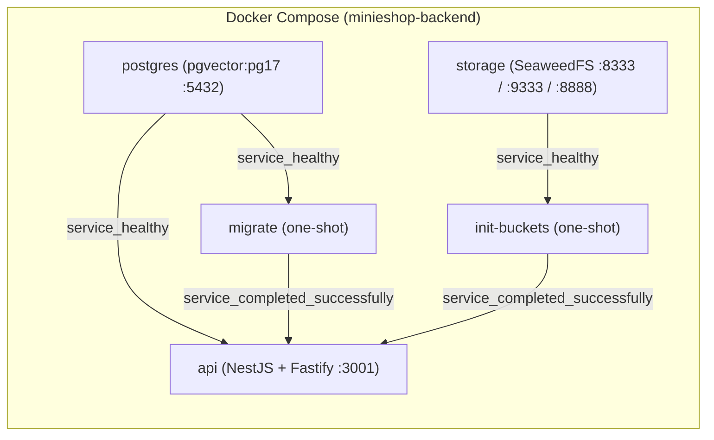

# Infraestrutura Local — Progressive Minie Shop Backend

Ambiente local containerizado com Docker Compose (testado no **OrbStack** / macOS) para a Fase 1 do backend, sem alterar o SPA React nem o `package.json` da raiz.

> **Nota de Monorepo:** os pacotes do backend (`apps/api`, `packages/contracts`, `packages/config`) usam `package.json` e `pnpm-lock.yaml` isolados via `link:`; a unificação em workspace `pnpm` na raiz acontecerá na **T20**.

---

## Quick Start

```bash
# 1. (Opcional) Copie o arquivo de ambiente caso queira customizar variáveis
cp infra/.env.example infra/.env

# 2. Suba todos os serviços (build, Postgres, SeaweedFS, init-buckets, migrate e API)
make -C infra up

# 3. Verifique saúde da API e prontidão do banco
curl http://localhost:3001/health
curl http://localhost:3001/ready

# 4. Hot reload em desenvolvimento (Docker Compose Watch)
make -C infra watch

# 5. Logs em tempo real
make -C infra logs

# 6. Recriar o ambiente do zero (apaga volumes, recria buckets e roda migrations)
make -C infra reset

# 7. Derrubar os containers (mantendo volumes)
make -C infra down
```

---

## Diagrama dos Serviços



---

## Portas e Endpoints

| Serviço | Porta Host | Endpoint / Função |
| :--- | :---: | :--- |
| `api` | `3001` | `GET /health` (liveness), `GET /ready` (readiness / `SELECT 1`) |
| `postgres` | `5432` | PostgreSQL 17 com `pgvector` |
| `storage` (S3) | `8333` | Gateway S3-compatível (endpoint público para o navegador e URLs assinadas) |
| `storage` (Master) | `9333` | Status do cluster (`/cluster/status`) e UI |
| `storage` (Filer) | `8888` | Interface do Filer SeaweedFS |

---

## Troubleshooting

- **Conflito de portas (`5432`, `3001`, `8333`):** ajuste `POSTGRES_PORT`, `API_PORT` ou `S3_PORT` em `infra/.env`.
- **Estado corrompido ou schema antigo:** execute `make -C infra reset` para apagar os volumes nomeados (`postgres_data`, `seaweedfs_data`) e recriar tudo do zero.
- **Healthcheck do SeaweedFS:** o gateway S3 (`:8333`) trata caminhos arbitrários como nomes de bucket, por isso o healthcheck valida o Master (`:9333/cluster/status`) e o Filer (`:8888/`), enquanto `init-buckets` valida o `weed shell` e cria os buckets público e privado antes da `api` subir.
- **Endpoints interno vs. público do S3:** dentro dos containers use `S3_ENDPOINT=http://storage:8333`; para URLs entregues ao navegador ou URLs assinadas use `S3_PUBLIC_ENDPOINT=http://localhost:8333`.
